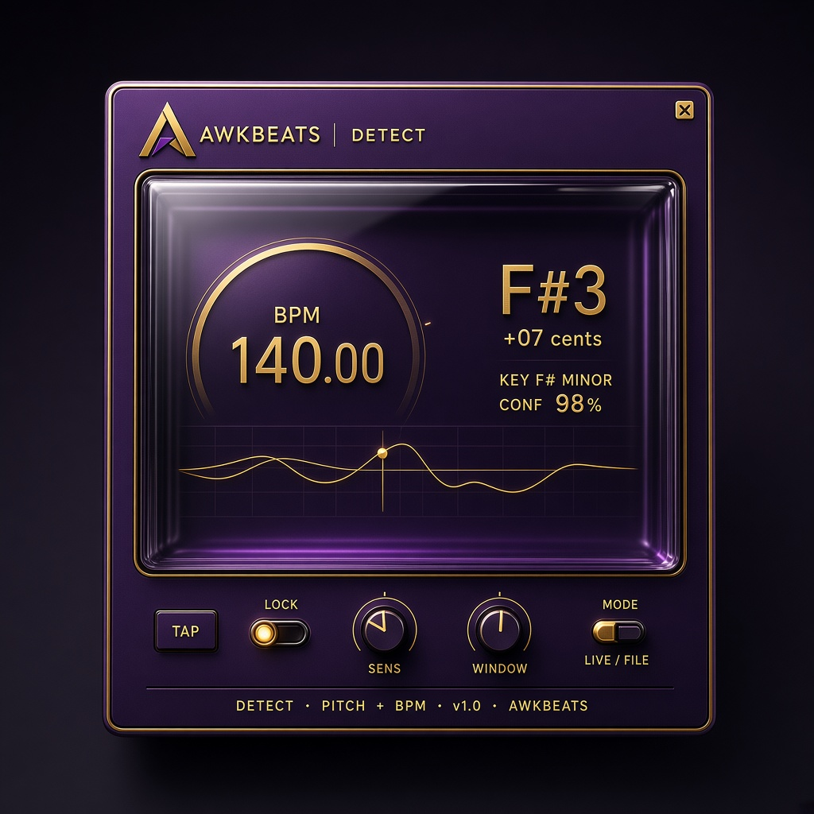
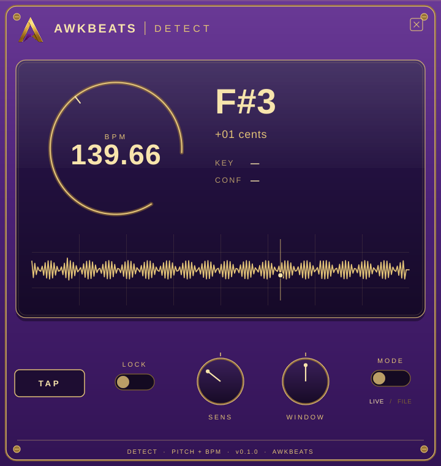

# Awk BK



*Design mockup. This is the visual reference for Awk BK. The shipping editor is the render further down the page.*

**Awk BK** is an AwkBeats VST3 analyzer that detects pitch (note + cents), musical key, and BPM from the audio running through it. The sound itself passes through unchanged.

It is aimed at producers working in FL Studio on Windows and macOS who want to read a beat's key, pitch, and tempo while they work. CI builds the plugin and runs the DSP tests without a DAW. Anthony Jaamal Jones scanned Awk BK in FL Studio on Windows and on macOS, and the plugin showed up in the scan. That scan does not measure in-host pitch or BPM accuracy, which is still unverified.

Made by **AwkBeats**, created by Anthony Jaamal Jones (Awkward J).

## Download

**[Awk BK v0.1.1](https://github.com/Awkward8787/Awk-BK-/releases/tag/v0.1.1)**

- [Windows installer (`AwkBK-windows-setup.exe`)](https://github.com/Awkward8787/Awk-BK-/releases/download/v0.1.1/AwkBK-windows-setup.exe). Installs into `C:\Program Files\Common Files\VST3\`
- [macOS installer (`AwkBK-macos.pkg`)](https://github.com/Awkward8787/Awk-BK-/releases/download/v0.1.1/AwkBK-macos.pkg). Installs into `/Library/Audio/Plug-Ins/VST3/`

The installers are unsigned. On Windows, SmartScreen may say "Windows protected your PC"; choose **More info**, then **Run anyway**. On macOS 15 and later, allow an unsigned plugin from **System Settings → Privacy & Security → Open Anyway**. On older macOS, right-click the package and choose **Open**. You can also clear quarantine:

```bash
xattr -dr com.apple.quarantine ~/Downloads/AwkBK-macos.pkg
```

After either installer finishes, open FL Studio and choose **Options → Manage plugins → Find plugins**. Confirm **Awk BK** by **AwkBeats** appears, then load it on a mixer track and route the audio you want to read into that track.

The raw plugin bundles are on the same release if you would rather copy them yourself: [AwkBK-windows.zip](https://github.com/Awkward8787/Awk-BK-/releases/download/v0.1.1/AwkBK-windows.zip) and [AwkBK-macos.zip](https://github.com/Awkward8787/Awk-BK-/releases/download/v0.1.1/AwkBK-macos.zip). Put `Awk BK.vst3` in `C:\Program Files\Common Files\VST3\` on Windows, or in `/Library/Audio/Plug-Ins/VST3/` (all users) or `~/Library/Audio/Plug-Ins/VST3/` (just you) on macOS. On macOS 15 and later, if the system blocks the bundle, use **System Settings → Privacy & Security → Open Anyway**. On older macOS, right-click the bundle and choose **Open**. You can also clear quarantine the same way as the package. Each zip includes `THIRD_PARTY_NOTICES.md`.

## Uninstall

**Windows:** In Settings, open Apps (Installed apps), choose **Awk BK VST3**, and uninstall. That removes `C:\Program Files\Common Files\VST3\Awk BK.vst3`. The installer keeps its uninstall files in `C:\Program Files\AwkBeats\Awk BK\`, outside the shared VST3 folder.

v0.1.1 wrote `unins000.exe` and `unins000.dat` into `C:\Program Files\Common Files\VST3\`. After you uninstall or upgrade that version, delete those two files if they are still there and no other installer put them there.

**macOS:** Delete `/Library/Audio/Plug-Ins/VST3/Awk BK.vst3`, then forget the installer receipt:

```bash
sudo pkgutil --forget com.awkbeats.awkbk
```

A zip install is removed by deleting `Awk BK.vst3` from the VST3 folder you copied it into.

## What it shows

- **Pitch:** note and octave (for example F#3) and cents sharp or flat. The tracker is YIN (de Cheveigné and Kawahara, Journal of the Acoustical Society of America, 2002).
- **Key:** a Krumhansl and Kessler (1982) profile match, such as `F# MINOR`, with a confidence percentage.
- **BPM:** tempo from an onset-energy autocorrelation written for this plugin, shown to two decimal places. Pitch and tempo run on a background thread. The audio callback only copies the input into a ring buffer and updates a cheap waveform meter.
- **TAP:** set the tempo by tapping. Ignored while Lock is on.
- **LOCK:** freeze the current pitch, key, and BPM readouts.
- **SENS:** detection sensitivity. Higher accepts weaker pitch and softer onsets.
- **WINDOW:** analysis length. Longer is steadier and slower.
- **MODE:** **LIVE** follows the input. **FILE** uses a longer window for bounced audio or playlist playback.

VST3 codes are `AwBt` / `AwBk` so the plugin does not collide with other ids. MIDI output is not part of this version. There is no network access, telemetry, or analytics.

Pitch detection is monophonic. A chord, a drum loop with no clear onsets, or atonal audio will wander or sit at low confidence. Tempo is most reliable with clear hits and can still land on half or double time. The key estimate needs several pitch classes; one held tone is not enough to name a key.

The picture at the top of this page is the design mockup. This is the running editor after a generated F#3 tone and a 140 BPM click train (the numbers come from the detector):



The header uses the official AwkBeats logo in `assets/AwkBeatsLogo.png`.

## License

Awk BK is licensed under the **GNU Affero General Public License v3.0**. See [LICENSE](LICENSE).

JUCE 7 and earlier offered a GPLv3 open-source option. From JUCE 8 onward the open-source license is the **AGPLv3** ([JUCE 8 licence](https://juce.com/legal/juce-8-licence/)). This project pins [JUCE 8.0.17-security](https://github.com/juce-framework/JUCE/releases/tag/8.0.17-security) via CMake FetchContent, so the plugin is AGPLv3. That is the license that allows shipping it without a paid JUCE license. A GPLv3-only grant would not cover linking this JUCE.

JUCE 8.0.17 does not draw the old JUCE splash screen (the `JUCE_DISPLAY_SPLASH_SCREEN` flag is ignored). The AGPL still applies: if you distribute the plugin, offer this source with it. For a VST3 installed on your own machine, the AGPL's extra network clause does not change normal use.

### Third-party terms

JUCE bundles the Steinberg VST 3 SDK. Since VST 3.8 that SDK is MIT licensed, and the notice is in [THIRD_PARTY_NOTICES.md](THIRD_PARTY_NOTICES.md), which is copied into the plugin bundle and the release archives. Shipping a `.vst3` is also covered by Steinberg’s VST 3 licensing terms: [VST 3 Licensing](https://steinbergmedia.github.io/vst3_dev_portal/pages/VST+3+Licensing/Index.html). JUCE’s own license text is [JUCE LICENSE.md](https://github.com/juce-framework/JUCE/blob/8.0.17-security/LICENSE.md). This paragraph is a pointer to those documents, not legal advice. The project owner states that they hold Steinberg VST 3 distribution rights; that statement is theirs and does not replace those terms or the AGPL.

## Releases

Starting with v0.1.1, each release includes a Windows installer (`AwkBK-windows-setup.exe`), a macOS installer (`AwkBK-macos.pkg`), the raw VST3 zips, a screenshot of the editor, and a short description of what the plugin does and who made it. v0.1.0 shipped as zips only and is superseded by v0.1.1. GitHub Actions builds both installers and the raw VST3 zips on pull requests, and publishes them when a version tag is pushed.

## Build

Requirements: CMake 3.22+, a C++17 compiler, and git (CMake downloads the pinned JUCE tag; it is not vendored).

**Windows:** Visual Studio 2022, or the Visual Studio 2022 Build Tools, with the Desktop development with C++ workload.

```bash
cmake -B build -DCMAKE_BUILD_TYPE=Release
cmake --build build --config Release --parallel
ctest --test-dir build -C Release --output-on-failure
```

The VST3 bundle is `Awk BK.vst3` under `build/AwkBK_artefacts/Release/VST3/`. The DSP tests (`AwkBKTests`) do not need a DAW. They check that a generated sine maps to the expected note and cents, and that a click train maps near the expected BPM. `AwkBKProcessorTests` constructs the processor, runs the analysis thread, and checks that Lock freezes the readouts. A separate source lint only reads `PluginProcessor.cpp` as text.

**Windows installer:** install [Inno Setup 6.7.1](https://jrsoftware.org/isinfo.php). CI installs the Chocolatey package `innosetup` at version 6.7.1. Build the Release VST3, then run `installer/windows/build-setup.ps1`. It writes `AwkBK-windows-setup.exe`. The installer is 64-bit Windows only (`ArchitecturesAllowed=x64`).

**macOS installer:** with Xcode command line tools installed, run `bash installer/macos/build-pkg.sh 0.1.2`. It writes `AwkBK-macos.pkg`. The CMake project builds a universal binary (`arm64` and `x86_64`) with a deployment target of macOS 11.

An optional offscreen editor snapshot can be built with `-DAWK_BUILD_PREVIEW=ON`. It is not part of CI, because it needs a display.

**Linux** (tests and a local VST3, not a release target):

```bash
sudo apt-get install -y build-essential cmake git pkg-config \
  libasound2-dev libfreetype6-dev libx11-dev libxrandr-dev \
  libxinerama-dev libxcursor-dev libxext-dev libxi-dev \
  libgl1-mesa-dev libjack-jackd2-dev
```
